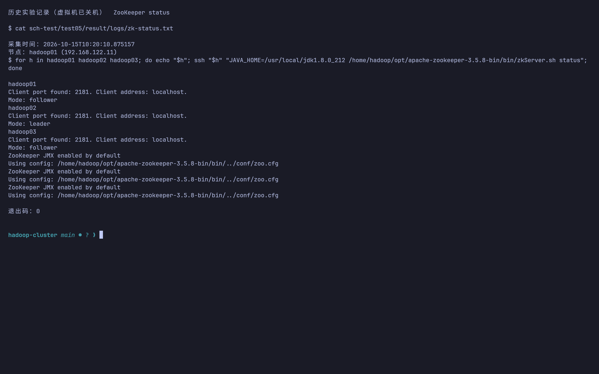
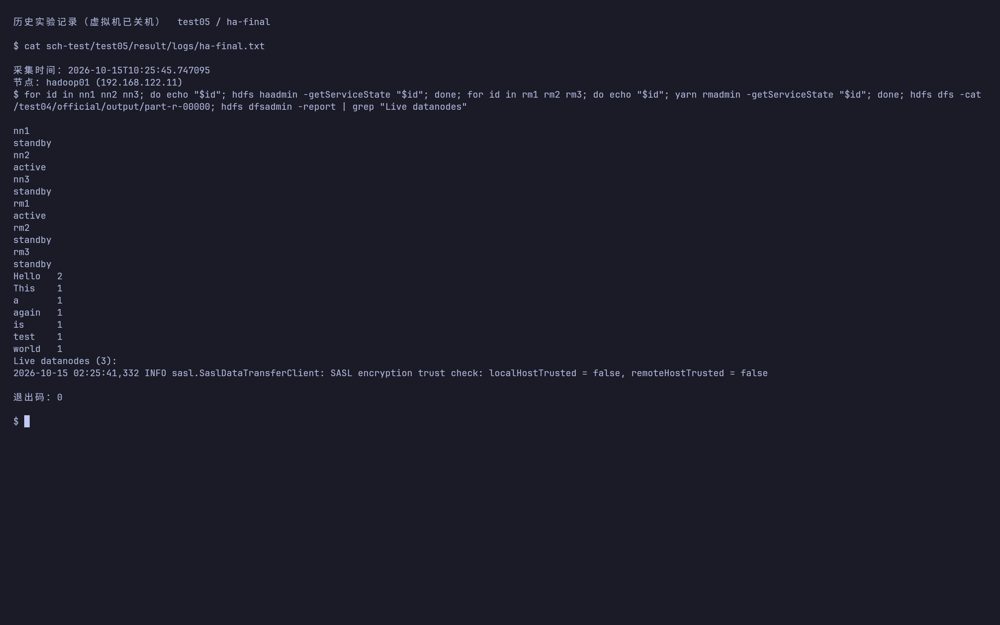
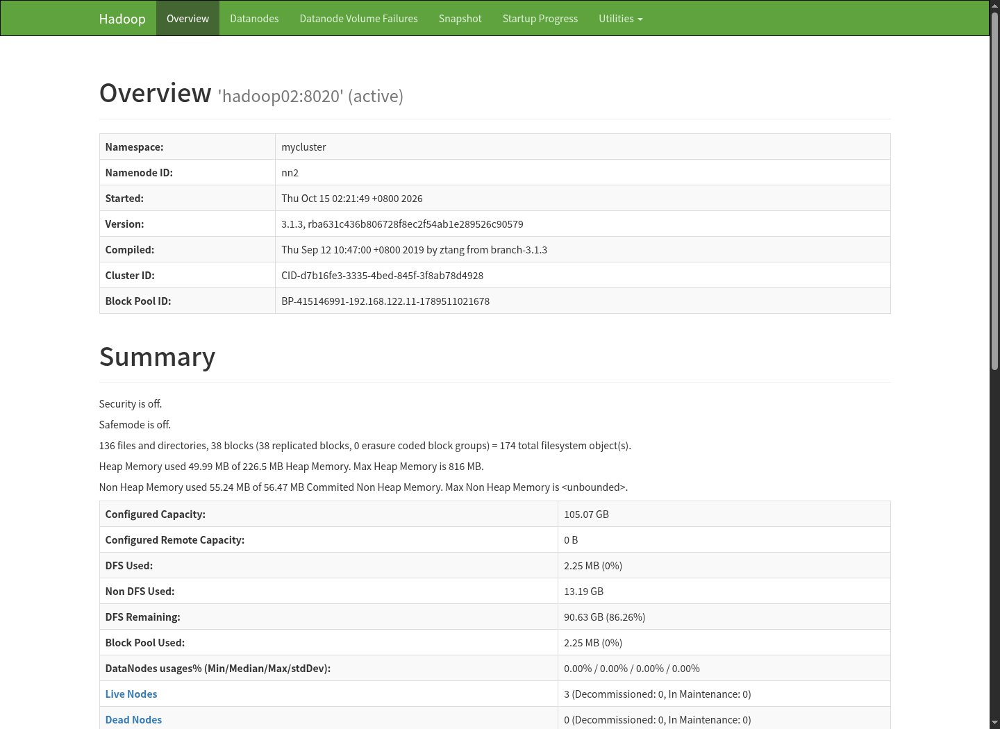
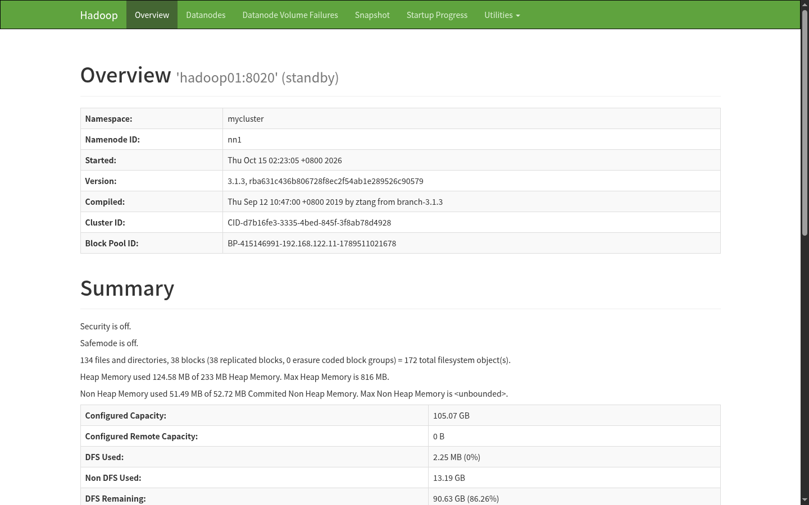
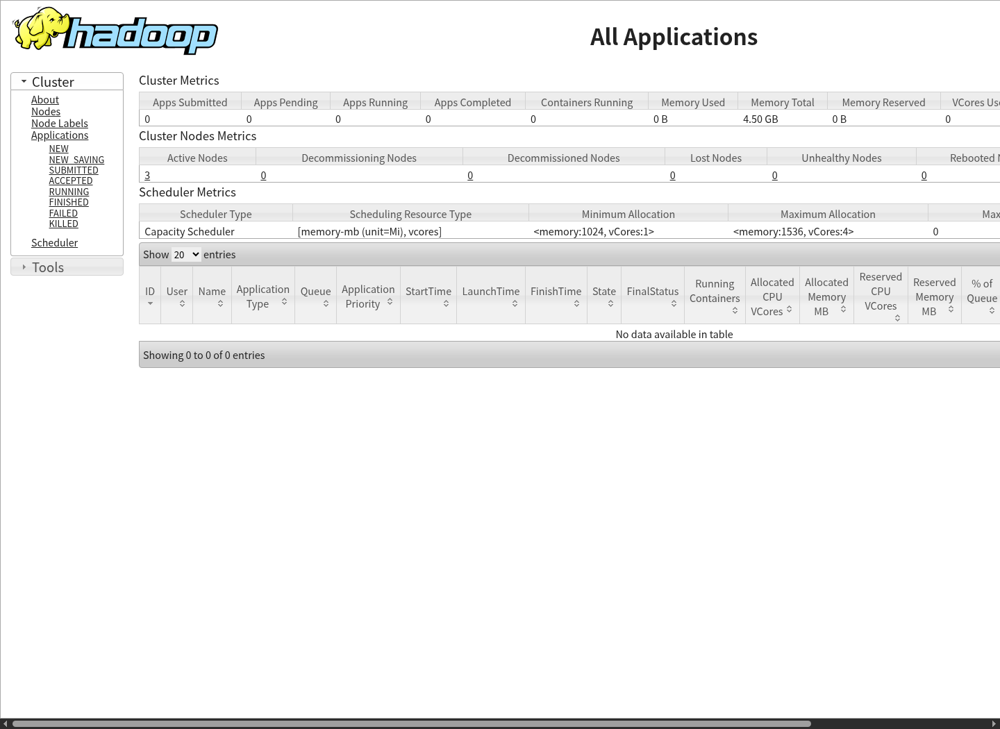

# 实验五 Hadoop HA 高可用集群操作步骤

## 实验目标与环境

完成 ZooKeeper 三节点集群、HDFS 三 NameNode HA 和 YARN 三 ResourceManager HA，验证主备状态与故障切换。

本实验已于 2026-10-15 在本项目的三台 KVM 虚拟机上执行。下文按“操作命令、结果、截图、说明”记录；`logs/` 保存真实 SSH 命令与完整输出。Web 配图为实际集群页面截图，命令配图为 Kitty 原生终端窗口截图：终端直接用 cat、sed 或 grep 回看已采集的 SSH 原始日志，截图由 grim 直接捕获，未使用 HTML 排版或图片转换。虚拟机在补截图时保持关机，因此这些是历史执行记录的终端截图。

三台虚拟机为 `hadoop01/02/03`（`192.168.122.11/12/13`），宿主机原 SSH 别名为 `h1/h2/h3`；若系统 SSH 配置报权限错误，使用 `ssh -F /dev/null hadoop@192.168.122.11`（其他节点替换末位）连接，传包同理使用 `scp -F /dev/null` 和显式地址。JDK 为 `/usr/local/jdk1.8.0_212`，Hadoop 为 `/usr/local/hadoop`。除注明“宿主机”外，均使用虚拟机的 `hadoop` 用户；跨节点命令使用集群主机名。

| 服务 | hadoop01 | hadoop02 | hadoop03 |
|---|---|---|---|
| ZooKeeper | myid=1 | myid=2 | myid=3 |
| NameNode / ZKFC | nn1 | nn2 | nn3 |
| JournalNode | 是 | 是 | 是 |
| ResourceManager | rm1 | rm2 | rm3 |
| DataNode / NodeManager | 是 | 是 | 是 |

HA 由 Standby NameNode 合并元数据，不再运行 SecondaryNameNode。JournalNode 多数派保存共享 edits，ZooKeeper 与 ZKFC 负责选举和自动切换。

## 本次实验结果与截图

| 验收项 | 实测结果 |
|---|---|
| ZooKeeper | hadoop02 为 leader，hadoop01/03 为 follower |
| HDFS HA | 最终 nn2 active，nn1/nn3 standby；3 个 DataNode 在线 |
| YARN HA | 最终 rm1 active，rm2/rm3 standby |
| 数据保留 | 原 `/test04/official/output/part-r-00000` 可读，Hello=2、其余词=1 |
| NN 自动切换 | 停止 nn3 后 nn2 接任，停止与查询合计约 3 秒 |
| RM 自动切换 | 停止 rm2 后 rm1 接任，停止与查询合计约 2 秒 |
| 切换后读取 | 两次均返回 `HA data survives failover` |

耗时由脚本墙钟秒数统计，包含停止命令和轮询，不是精确服务中断时间。被停服务均已恢复为 standby。












元数据迁移记录：[共享日志初始化](logs/ha-migration-hadoop01.txt)、[hadoop02 同步](logs/ha-bootstrap-hadoop02.txt)、[hadoop03 同步](logs/ha-bootstrap-hadoop03.txt)。

完整原始证据：[ZooKeeper](logs/zk-status.txt)、[初始主备状态](logs/ha-status.txt)、[自动切换](logs/failover.txt)、[最终主备及数据](logs/ha-final.txt)。可复用切换脚本为 [failover.sh](../failover.sh)，在 hadoop01 上以 hadoop 用户执行；不要在作业运行时重复测试。

以下安装与迁移章节记录首次执行过程；本项目现在已完成 HA，日常使用从第 5/7 节的检查与启停开始，不要重复初始化 shared edits、bootstrapStandby 或 formatZK。备份目录本次统一为三机的 `~/lab-backup-before-ha/`。

## 1. 停止服务并备份现有集群

先在宿主机启动虚拟机并登录：

```bash
cd /home/nanfl/Projects/hadoop-cluster
./start-cluster.sh
ssh -F /dev/null hadoop@192.168.122.11
```

在 hadoop01 停止原服务：

```bash
mapred --daemon stop historyserver
stop-yarn.sh
stop-dfs.sh
```

三台机器分别执行以下备份，确认磁盘空间足够，并记录备份目录：

```bash
backup="$HOME/backup-before-ha-$(date +%Y%m%d-%H%M%S)"
mkdir -p "$backup"
cp -a /usr/local/hadoop/etc/hadoop "$backup/"
[ ! -d /usr/local/hadoop/data ] || cp -a /usr/local/hadoop/data "$backup/"
printf '备份目录：%s
' "$backup"
```

本项目已有实验三、四数据，下面采用保留原 NameNode 与 DataNode 存储目录的迁移方式。不要执行原手册中的删除 `data`、删除 `logs` 和 `namenode -format`。若改为全新空集群，应单独规划数据目录并在确认无旧数据后初始化，不能与迁移流程混用。

## 2. 安装 ZooKeeper

在宿主机项目根目录向三台机器传包：

```bash
for host in 192.168.122.11 192.168.122.12 192.168.122.13; do
  scp -F /dev/null apache-zookeeper-3.5.8-bin.tar.gz "hadoop@$host:/tmp/"
done
```

三台虚拟机分别执行：

```bash
mkdir -p ~/opt
tar -xzf /tmp/apache-zookeeper-3.5.8-bin.tar.gz -C ~/opt
mkdir -p /home/hadoop/opt/apache-zookeeper-3.5.8-bin/zkData
cat > /home/hadoop/opt/apache-zookeeper-3.5.8-bin/conf/zoo.cfg <<'EOF'
tickTime=2000
initLimit=10
syncLimit=5
dataDir=/home/hadoop/opt/apache-zookeeper-3.5.8-bin/zkData
clientPort=2181
server.1=hadoop01:2888:3888
server.2=hadoop02:2888:3888
server.3=hadoop03:2888:3888
EOF
```

各节点分别写入自己的编号，只执行对应的一行：

```bash
# hadoop01
echo 1 > /home/hadoop/opt/apache-zookeeper-3.5.8-bin/zkData/myid
# hadoop02
echo 2 > /home/hadoop/opt/apache-zookeeper-3.5.8-bin/zkData/myid
# hadoop03
echo 3 > /home/hadoop/opt/apache-zookeeper-3.5.8-bin/zkData/myid
```

在 hadoop01 创建集群管理脚本：

```bash
mkdir -p ~/bin
cat > ~/bin/zk <<'EOF'
#!/usr/bin/env bash
set -euo pipefail
case "${1:-}" in
  start|stop|status) ;;
  *) echo "用法: $0 start|stop|status"; exit 1 ;;
esac
for host in hadoop01 hadoop02 hadoop03; do
  echo "===== $host ====="
  ssh "$host" "JAVA_HOME=/usr/local/jdk1.8.0_212 /home/hadoop/opt/apache-zookeeper-3.5.8-bin/bin/zkServer.sh $1"
done
EOF
chmod +x ~/bin/zk
~/bin/zk start
~/bin/zk status
```

预期一个 leader、两个 follower，三台均有 `QuorumPeerMain`。启动初期尚未选举完时稍后再查。

## 3. 修改 Hadoop HA 配置

在 hadoop01 修改 `/usr/local/hadoop/etc/hadoop/` 下的配置。以下属性放入各自唯一的 `<configuration>` 元素内，已有同名属性直接修改，避免重复。保留原有 MapReduce 类路径、NodeManager 内存等设置。

### 3.1 core-site.xml

将 `fs.defaultFS` 改成逻辑集群名称，保留原临时目录：

```xml
<property><name>fs.defaultFS</name><value>hdfs://mycluster</value></property>
<property><name>hadoop.tmp.dir</name><value>/usr/local/hadoop/tmp</value></property>
<property><name>ha.zookeeper.quorum</name><value>hadoop01:2181,hadoop02:2181,hadoop03:2181</value></property>
```

### 3.2 hdfs-site.xml

删除原非 HA 的单实例 RPC/HTTP 地址及 SecondaryNameNode 地址配置，保留 `dfs.namenode.rpc-bind-host`、`dfs.namenode.http-bind-host` 等绑定设置。合并下列属性，原元数据目录保持不变：

```xml
<property><name>dfs.replication</name><value>2</value></property>
<property><name>dfs.namenode.name.dir</name><value>file:///usr/local/hadoop/data/namenode</value></property>
<property><name>dfs.datanode.data.dir</name><value>file:///usr/local/hadoop/data/datanode</value></property>
<property><name>dfs.journalnode.edits.dir</name><value>/usr/local/hadoop/data/journalnode</value></property>
<property><name>dfs.nameservices</name><value>mycluster</value></property>
<property><name>dfs.ha.namenodes.mycluster</name><value>nn1,nn2,nn3</value></property>
<property><name>dfs.namenode.rpc-address.mycluster.nn1</name><value>hadoop01:8020</value></property>
<property><name>dfs.namenode.rpc-address.mycluster.nn2</name><value>hadoop02:8020</value></property>
<property><name>dfs.namenode.rpc-address.mycluster.nn3</name><value>hadoop03:8020</value></property>
<property><name>dfs.namenode.http-address.mycluster.nn1</name><value>hadoop01:9870</value></property>
<property><name>dfs.namenode.http-address.mycluster.nn2</name><value>hadoop02:9870</value></property>
<property><name>dfs.namenode.http-address.mycluster.nn3</name><value>hadoop03:9870</value></property>
<property><name>dfs.namenode.shared.edits.dir</name><value>qjournal://hadoop01:8485;hadoop02:8485;hadoop03:8485/mycluster</value></property>
<property><name>dfs.client.failover.proxy.provider.mycluster</name><value>org.apache.hadoop.hdfs.server.namenode.ha.ConfiguredFailoverProxyProvider</value></property>
<property><name>dfs.ha.fencing.methods</name><value>sshfence</value></property>
<property><name>dfs.ha.fencing.ssh.private-key-files</name><value>/home/hadoop/.ssh/id_rsa</value></property>
<property><name>dfs.ha.automatic-failover.enabled</name><value>true</value></property>
```

三台 NameNode 必须能以 `hadoop` 用户相互 SSH 免密登录；确认上面的私钥路径确实存在，目标节点具备 `fuser`（AlmaLinux 的 `psmisc` 包）。不要用固定返回成功的 fencing 命令绕过隔离。

### 3.3 yarn-site.xml

移除原不带 RM ID 的 `yarn.resourcemanager.hostname`，增加以下配置：

```xml
<property><name>yarn.resourcemanager.ha.enabled</name><value>true</value></property>
<property><name>yarn.resourcemanager.cluster-id</name><value>cluster-yarn1</value></property>
<property><name>yarn.resourcemanager.ha.rm-ids</name><value>rm1,rm2,rm3</value></property>
<property><name>yarn.resourcemanager.hostname.rm1</name><value>hadoop01</value></property>
<property><name>yarn.resourcemanager.hostname.rm2</name><value>hadoop02</value></property>
<property><name>yarn.resourcemanager.hostname.rm3</name><value>hadoop03</value></property>
<property><name>yarn.resourcemanager.webapp.address.rm1</name><value>hadoop01:8088</value></property>
<property><name>yarn.resourcemanager.webapp.address.rm2</name><value>hadoop02:8088</value></property>
<property><name>yarn.resourcemanager.webapp.address.rm3</name><value>hadoop03:8088</value></property>
<property><name>yarn.resourcemanager.zk-address</name><value>hadoop01:2181,hadoop02:2181,hadoop03:2181</value></property>
<property><name>yarn.resourcemanager.recovery.enabled</name><value>true</value></property>
<property><name>yarn.resourcemanager.store.class</name><value>org.apache.hadoop.yarn.server.resourcemanager.recovery.ZKRMStateStore</value></property>
<property><name>yarn.nodemanager.aux-services</name><value>mapreduce_shuffle</value></property>
```

本次在各节点明确增加 `yarn.resourcemanager.ha.id=rm1/rm2/rm3`，此项不能原样同步。本次 `yarn.nodemanager.resource.memory-mb=1536`，为 HBase/Kafka 预留内存。RPC、scheduler、resource-tracker 等使用各 RM 主机对应的默认端口。

### 3.4 本次实际修复与节点配置

本机 Java 在监听地址 `0.0.0.0` 上执行反向 DNS 查询时卡住，`jstack` 显示 `Inet4AddressImpl.getHostByAddr`。本次将 NN 的 RPC/HTTP bind-host、RM bind-host 改为对应节点主机名，并补充 JournalNode 地址（下面是 hadoop01，其他节点替换主机名）：

```xml
<property><name>dfs.journalnode.rpc-address</name><value>hadoop01:8485</value></property>
<property><name>dfs.journalnode.rpc-bind-host</name><value>hadoop01</value></property>
<property><name>dfs.journalnode.http-address</name><value>hadoop01:8480</value></property>
```

节点配置因此不同，实际完整文件已保存于 [config](../config/)，复现时使用各自子目录，不能将 hadoop01 的绑定地址与 RM ID 原样分发。

hadoop02/03 原来没有 SSH 私钥与反向免密，分别执行 `ssh-keygen -t rsa -b 3072 -m PEM -N "" -f ~/.ssh/id_rsa`，将三机公钥追加到三机 `authorized_keys`，并将三机主机密钥加入 `known_hosts`。已有 OpenSSH 格式 RSA 私钥可执行 `ssh-keygen -p -m PEM -P "" -N "" -f ~/.ssh/id_rsa` 转换；旧 JSch 否则报 `invalid privatekey`。

虚拟机有 `fuser`，但缺少 `nc`。已在三机 `~/bin/nc` 安装 [TCP 探测脚本](../nc-tcp-probe.sh)，仅实现 fencing 所需的 `nc -z HOST PORT`；开放端口返回 0，拒绝或超时返回非零，已检查 22 与 1 端口。该脚本位于远程 SSH 的 PATH 中，防止把“命令缺失”误判为服务已经隔离。首次发现此问题的切换不作为最终验收，修复后重新测试。

### 3.5 分发配置

将 `workers` 改成三行：

```text
hadoop01
hadoop02
hadoop03
```

在 hadoop01 分发共享配置：

```bash
for host in hadoop02 hadoop03; do
  scp /usr/local/hadoop/etc/hadoop/{core-site.xml,hdfs-site.xml,yarn-site.xml,workers}     "$host:/usr/local/hadoop/etc/hadoop/"
done
```

## 4. 从原单 NameNode 迁移到 HA

确认原服务已停、备份完整，且 hadoop02/03 没有需要保留的 NameNode 元数据。三台节点先启动 JournalNode：

```bash
# 三台节点分别执行
hdfs --daemon start journalnode
```

在 hadoop01 使用原 NameNode 元数据初始化共享日志，只有首次迁移才执行：

```bash
hdfs namenode -initializeSharedEdits
hdfs --daemon start namenode
```

若提示覆盖已经存在的共享日志，应停止检查是否重复初始化，不要强制覆盖。然后在 hadoop02 和 hadoop03 分别同步元数据：

```bash
hdfs namenode -bootstrapStandby
```

返回 hadoop01 停止临时 NameNode，首次初始化 ZKFC 的选举目录：

```bash
hdfs --daemon stop namenode
hdfs zkfc -formatZK
start-dfs.sh
```

`-bootstrapStandby` 只用于新增备节点；`-formatZK` 也不应在日常启动时重复执行。共享 JournalNode 已在运行时，启动脚本可能提示进程已启动。

## 5. 启动 YARN 并验证主备

在 hadoop01 启动 YARN，再检查三台 ResourceManager 是否齐全；缺少的节点分别补启：

```bash
start-yarn.sh
# 仅在对应节点尚无 ResourceManager 时执行
# yarn --daemon start resourcemanager
mapred --daemon start historyserver
```

在 hadoop01 检查：

```bash
for id in nn1 nn2 nn3; do hdfs haadmin -getServiceState "$id"; done
for id in rm1 rm2 rm3; do yarn rmadmin -getServiceState "$id"; done
hdfs dfsadmin -report
hdfs dfs -ls /
```

NameNode 和 ResourceManager 应各只有一个 active、两个 standby，DataNode 应全部存活。各节点 `jps` 应有 NameNode、JournalNode、DFSZKFailoverController、DataNode、ResourceManager、NodeManager、QuorumPeerMain；历史服务仅 hadoop01 启动。

浏览器分别访问三台 IP 的 `9870`，核对 Active/Standby；访问 `8088`，观察备用 RM 页面跳转。实际主节点由选举决定，不固定为 hadoop01。

## 6. 验证切换与 HDFS 访问

先使用服务状态命令找到 Active 所在主机，在该主机停止 NameNode：

```bash
hdfs --daemon stop namenode
```

在仍运行的节点反复查询三台 NN 状态，预期剩余节点之一变成 active，停止的节点查询可能连接失败；确认原 HDFS 文件仍可读取。随后在被停节点执行 `hdfs --daemon start namenode`，应作为 standby 回归。

同理在当前 Active RM 节点执行 `yarn --daemon stop resourcemanager`，检查其余 RM 的状态，再以 `yarn --daemon start resourcemanager` 恢复。记录切换前后主机名与耗时，截取真实状态输出，不以 `jps` 存在代替切换验证。

## 7. 完成检查与日常启停

- ZooKeeper 为一个 leader、两个 follower。
- 三个 NameNode 与三个 RM 分别只有一个 active。
- 原 HDFS 数据仍在，逻辑入口 `hdfs://mycluster` 可用。
- 停止当前主服务后可自动切换，恢复后形成稳定主备。

启动顺序为 ZooKeeper → HDFS → YARN → 历史服务；停止时反序执行。项目 `start-cluster.sh` 已增加 HA 检测和 ZooKeeper 启动；`stop-cluster.sh` 按 HBase/Kafka → Hadoop → ZooKeeper 顺序停止，虚拟机保持运行。

若 NN 无法切换，检查 ZooKeeper 多数派、ZKFC 日志、SSH 隔离与 JournalNode；若提示 clusterID 不一致，核查数据目录和迁移步骤，不要通过重新格式化消除报错。

## 配置参考

保留原 NameNode 元数据并初始化共享 edits 的流程参照 [Apache Hadoop HA 配置说明](https://hadoop.apache.org/docs/r3.1.3/hadoop-project-dist/hadoop-hdfs/HDFSHighAvailabilityWithQJM.html)；使用项目现有 3.1.3 版本。
