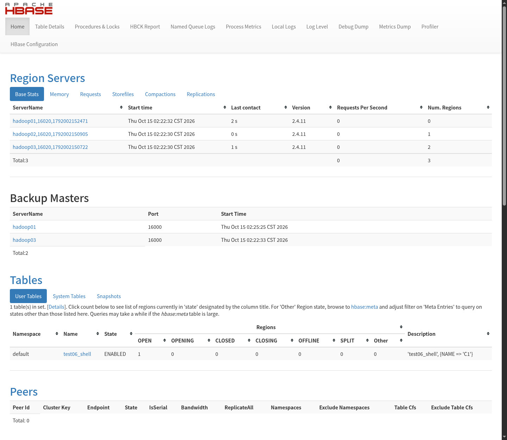
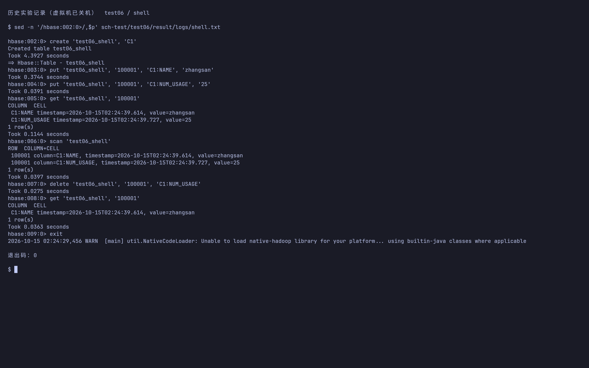
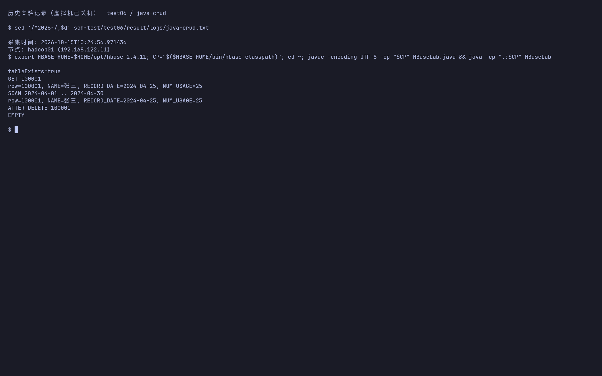
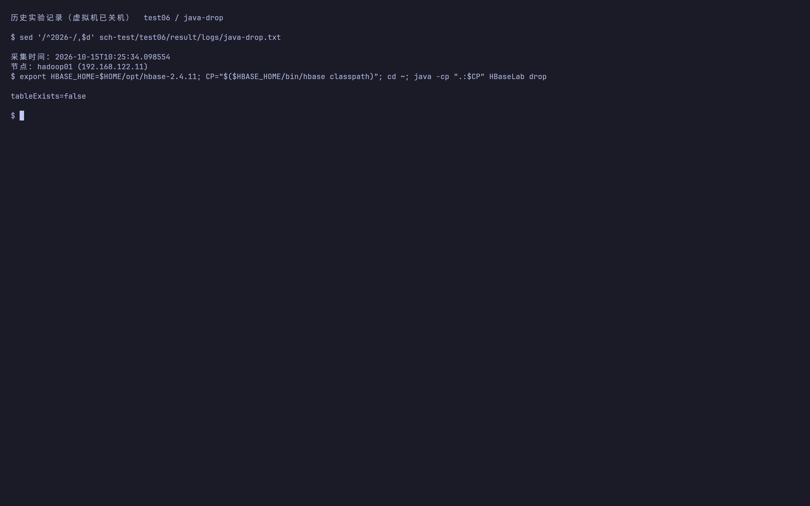
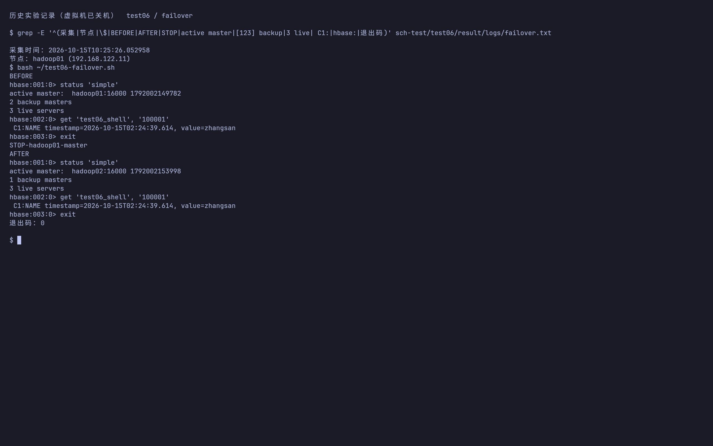

# 实验六 HBase HA 集群搭建与编程实践操作步骤

## 实验目标与环境

部署 HBase 2.4.11，配置一个 Active HMaster、两个备用 HMaster 和三个 RegionServer；使用 Shell 与 Java API 完成建表、写入、读取、删除和条件扫描。

本实验已于 2026-10-15 在本项目的三台 KVM 虚拟机上执行。下文按“操作命令、结果、截图、说明”记录；`logs/` 保存真实 SSH 命令与完整输出。Web 配图为实际集群页面截图，命令配图为 Kitty 原生终端窗口截图：终端直接用 cat、sed 或 grep 回看已采集的 SSH 原始日志，截图由 grim 直接捕获，未使用 HTML 排版或图片转换。虚拟机在补截图时保持关机，因此这些是历史执行记录的终端截图。

三台虚拟机为 `hadoop01/02/03`（`192.168.122.11/12/13`），宿主机原 SSH 别名为 `h1/h2/h3`；若系统 SSH 配置报权限错误，使用 `ssh -F /dev/null hadoop@192.168.122.11`（其他节点替换末位）连接，传包同理使用 `scp -F /dev/null` 和显式地址。JDK 为 `/usr/local/jdk1.8.0_212`，Hadoop 为 `/usr/local/hadoop`。除注明“宿主机”外，均使用虚拟机的 `hadoop` 用户；跨节点命令使用集群主机名。

前置条件：先完成 [实验五](../../test05/result/test05.md)，确认 `hdfs://mycluster` 可读写、ZooKeeper 多数派正常。本文使用已有的外部 ZooKeeper，HBase 不单独启动一套 ZooKeeper。

## 本次实验结果与截图

| 验收项 | 实测结果 |
|---|---|
| HA 拓扑 | 1 个 Active HMaster、2 个 Backup、3 个 live RegionServer、0 个 dead |
| Shell | 建表、put、get、scan、delete 成功；删除 NUM_USAGE 后 NAME 保留 |
| Java Admin | 建表 `tableExists=true`；禁用并删除后 `tableExists=false` |
| Java CRUD | GET 返回张三、日期与用量；删除 100001 后返回 EMPTY |
| 日期过滤 | 2024-04-01 至 2024-06-30 仅返回 100001，排除 2024-07-01 的 100002 |
| HMaster 切换 | 停止 hadoop01 的 master，hadoop02 接任；切换后 NAME 仍可读取 |
| 恢复 | hadoop01 已作为备用恢复，重新形成 2 个 Backup Master |

本次没有关闭 WAL 流能力检查，没有替换或混拷 JAR。首次启动恰逢 HDFS 故障测试，HBase 等待 HA 重试后成功初始化；报告中的 Java 验收是服务就绪后再次执行的输出。











原始日志：[Shell 与详细集群状态](logs/shell.txt)、[Java CRUD](logs/java-crud.txt)、[删除表](logs/java-drop.txt)、[主备切换](logs/failover.txt)、[恢复后的状态](logs/restored.txt)。源文件 [HBaseLab.java](../HBaseLab.java)、Shell 批处理 [shell.hbase](../shell.hbase) 和 [failover.sh](../failover.sh) 一并保存。Java 专用表已按实验删除，Shell 表保留供验收；再次运行 Shell 脚本前需先确认同名表是否已存在。

## 1. 安装 HBase

在宿主机项目根目录执行：

```bash
for host in 192.168.122.11 192.168.122.12 192.168.122.13; do
  scp -F /dev/null hbase-2.4.11-bin.tar.gz "hadoop@$host:/tmp/"
done
```

三台虚拟机分别执行：

```bash
mkdir -p ~/opt
tar -xzf /tmp/hbase-2.4.11-bin.tar.gz -C ~/opt
```

三台的 `~/.bashrc` 增加以下环境变量，然后执行 `source ~/.bashrc`：

```bash
export HBASE_HOME=/home/hadoop/opt/hbase-2.4.11
export PATH="$HBASE_HOME/bin:$PATH"
```

在 hadoop01 的 `/home/hadoop/opt/hbase-2.4.11/conf/hbase-env.sh` 设置：

```bash
export JAVA_HOME=/usr/local/jdk1.8.0_212
export HBASE_MANAGES_ZK=false
export HBASE_DISABLE_HADOOP_CLASSPATH_LOOKUP=true
export HBASE_HEAPSIZE=384
```

最后一项避免启动脚本额外引入整套外部 Hadoop 类路径。HDFS HA 客户端配置仍需按下一节复制。

已检查本地安装包：其中捆绑的是 Hadoop 2.10.0 客户端类库，而服务端为 Hadoop 3.1.3。本次保留发行包原有依赖，已实际验证本报告列出的 Shell/Java API 与 HMaster 切换；这不等同于全部兼容性认证。若其他操作出现类缺失、方法不匹配或 WAL 错误，应按 [HBase 2.4 官方参考文档](https://hbase.apache.org/2.4/book.html) 核对构建与依赖兼容性，不要任意混拷不同版本的 JAR。

## 2. 配置 HDFS、ZooKeeper 和主备节点

在 hadoop01 编辑 `/home/hadoop/opt/hbase-2.4.11/conf/hbase-site.xml`：

```xml
<?xml version="1.0"?>
<configuration>
  <property><name>hbase.rootdir</name><value>hdfs://mycluster/hbase</value></property>
  <property><name>hbase.cluster.distributed</name><value>true</value></property>
  <property><name>hbase.zookeeper.quorum</name><value>hadoop01,hadoop02,hadoop03</value></property>
  <property><name>hbase.zookeeper.property.clientPort</name><value>2181</value></property>
</configuration>
```

`mycluster` 是 HDFS 的逻辑名称，不附加某台 NameNode 的 `8020` 端口。复制实验五生成的配置，使 HBase 知道三个 NN 的地址和客户端故障转移类：

```bash
cp /usr/local/hadoop/etc/hadoop/{core-site.xml,hdfs-site.xml}   /home/hadoop/opt/hbase-2.4.11/conf/
printf 'hadoop01
hadoop02
hadoop03
' > /home/hadoop/opt/hbase-2.4.11/conf/regionservers
printf 'hadoop02
hadoop03
' > /home/hadoop/opt/hbase-2.4.11/conf/backup-masters
for host in hadoop02 hadoop03; do
  scp /home/hadoop/opt/hbase-2.4.11/conf/{hbase-env.sh,hbase-site.xml,core-site.xml,hdfs-site.xml,regionservers,backup-masters}     "$host:/home/hadoop/opt/hbase-2.4.11/conf/"
done
```

备用主节点文件名为 **`backup-masters`**，不是手册中的 `backup-master`。已有外部 ZooKeeper 时不用通过 HBase 配置管理 ZooKeeper 数据目录。

若启动日志明确提示 WAL 文件系统不支持所需流能力，应先检查 HBase 发行包与 Hadoop 的兼容性和 HDFS 配置；手册的 `hbase.unsafe.stream.capability.enforce=false` 会关闭能力校验，不作为默认配置。

## 3. 启动并检查服务

在 hadoop01 检查前置服务，未启动时先按实验五启动：

```bash
~/bin/zk status
hdfs dfs -ls /
for id in nn1 nn2 nn3; do hdfs haadmin -getServiceState "$id"; done
/home/hadoop/opt/hbase-2.4.11/bin/start-hbase.sh
```

分别在三台节点执行 `jps`。预期每台有 `HRegionServer`，hadoop01 有一个 `HMaster`，hadoop02/03 各有备用 `HMaster`。`jps` 只能证明进程存在，主备身份需要从 Web 页面或 HBase 状态确认。

宿主机浏览器访问：

- <http://192.168.122.11:16010>
- <http://192.168.122.12:16010>
- <http://192.168.122.13:16010>

检查 Active Master、Backup Masters 和在线 RegionServer 数量。首次部署预期三个 RegionServer 在线；Active 的具体节点以当前选举为准。

## 4. 用 HBase Shell 验证读写

在 hadoop01 启动 Shell：

```bash
/home/hadoop/opt/hbase-2.4.11/bin/hbase shell
```

以下命令在 HBase Shell 执行，不是在 Bash 执行。表已存在时跳过 `create`：

```ruby
status 'detailed'
create 'test06_shell', 'C1'
put 'test06_shell', '100001', 'C1:NAME', '张三'
put 'test06_shell', '100001', 'C1:RECORD_DATE', '2024-04-25'
get 'test06_shell', '100001'
scan 'test06_shell'
delete 'test06_shell', '100001', 'C1:NAME'
get 'test06_shell', '100001'
exit
```

第一次读取应有两个单元格；删除 `C1:NAME` 后只保留日期列。后续 Java 示例使用另一张表，避免与本节数据相互影响。

## 5. 编写 Java API 示例

与实验四一致，直接使用节点上的 JDK 和组件类库编译。这样不依赖 IDEA、Maven、JUnit 或 Lombok，代码仍覆盖手册要求的 Admin、Put、Get、Delete、Scan 和 Filter。

在 hadoop01 执行：

```bash
mkdir -p ~/hbase-lab
cd ~/hbase-lab
cat > HBaseLab.java <<'EOF'
import org.apache.hadoop.conf.Configuration;
import org.apache.hadoop.hbase.HBaseConfiguration;
import org.apache.hadoop.hbase.TableName;
import org.apache.hadoop.hbase.CompareOperator;
import org.apache.hadoop.hbase.client.*;
import org.apache.hadoop.hbase.filter.*;
import org.apache.hadoop.hbase.util.Bytes;

public class HBaseLab {
    private static final TableName NAME = TableName.valueOf("test06_api");
    private static final byte[] CF = Bytes.toBytes("C1");
    private static void print(Result result) {
        if (result.isEmpty()) {
            System.out.println("EMPTY");
            return;
        }
        System.out.println("row=" + Bytes.toString(result.getRow())
            + ", NAME=" + Bytes.toString(result.getValue(CF, Bytes.toBytes("NAME")))
            + ", RECORD_DATE=" + Bytes.toString(result.getValue(CF, Bytes.toBytes("RECORD_DATE")))
            + ", NUM_USAGE=" + Bytes.toString(result.getValue(CF, Bytes.toBytes("NUM_USAGE"))));
    }
    private static Put row(String key, String name, String date, String usage) {
        Put put = new Put(Bytes.toBytes(key));
        put.addColumn(CF, Bytes.toBytes("NAME"), Bytes.toBytes(name));
        put.addColumn(CF, Bytes.toBytes("RECORD_DATE"), Bytes.toBytes(date));
        put.addColumn(CF, Bytes.toBytes("NUM_USAGE"), Bytes.toBytes(usage));
        return put;
    }
    public static void main(String[] args) throws Exception {
        Configuration conf = HBaseConfiguration.create();
        try (Connection connection = ConnectionFactory.createConnection(conf);
             Admin admin = connection.getAdmin()) {
            if (args.length == 1 && "drop".equals(args[0])) {
                if (admin.tableExists(NAME)) {
                    if (admin.isTableEnabled(NAME)) admin.disableTable(NAME);
                    admin.deleteTable(NAME);
                }
                System.out.println("tableExists=" + admin.tableExists(NAME));
                return;
            }
            if (!admin.tableExists(NAME)) {
                admin.createTable(TableDescriptorBuilder.newBuilder(NAME)
                    .setColumnFamily(ColumnFamilyDescriptorBuilder.of(CF)).build());
            }
            System.out.println("tableExists=" + admin.tableExists(NAME));
            try (Table table = connection.getTable(NAME)) {
                table.put(row("100001", "张三", "2024-04-25", "25"));
                table.put(row("100002", "李四", "2024-07-01", "30"));
                System.out.println("GET 100001");
                print(table.get(new Get(Bytes.toBytes("100001"))));
                SingleColumnValueFilter lower = new SingleColumnValueFilter(CF,
                    Bytes.toBytes("RECORD_DATE"), CompareOperator.GREATER_OR_EQUAL,
                    new BinaryComparator(Bytes.toBytes("2024-04-01")));
                SingleColumnValueFilter upper = new SingleColumnValueFilter(CF,
                    Bytes.toBytes("RECORD_DATE"), CompareOperator.LESS_OR_EQUAL,
                    new BinaryComparator(Bytes.toBytes("2024-06-30")));
                lower.setFilterIfMissing(true);
                upper.setFilterIfMissing(true);
                Scan scan = new Scan();
                scan.setFilter(new FilterList(FilterList.Operator.MUST_PASS_ALL, lower, upper));
                System.out.println("SCAN 2024-04-01 .. 2024-06-30");
                try (ResultScanner scanner = table.getScanner(scan)) {
                    for (Result result : scanner) print(result);
                }
                table.delete(new Delete(Bytes.toBytes("100001")));
                System.out.println("AFTER DELETE 100001");
                print(table.get(new Get(Bytes.toBytes("100001"))));
            }
        }
    }
}
EOF
export JAVA_HOME=/usr/local/jdk1.8.0_212
export PATH="$JAVA_HOME/bin:$PATH"
export HBASE_HOME=/home/hadoop/opt/hbase-2.4.11
CP="$($HBASE_HOME/bin/hbase classpath)"
javac -encoding UTF-8 -cp "$CP" HBaseLab.java
java -cp ".:$CP" HBaseLab
```

实测 `tableExists=true`；GET 显示张三；日期扫描仅返回 `100001`，排除 `100002`；删除后 GET 返回 `EMPTY`。`yyyy-MM-dd` 采用固定宽度，字符串比较与日期先后顺序一致。示例数值以字符串写入并按字符串读取，修正手册中“字符串写入、double 读取”的不一致。`setFilterIfMissing(true)` 排除没有日期列的行。

如课程要求使用 Maven，在 `pom.xml` 添加 `org.apache.hbase:hbase-client:2.4.11`，与服务端统一版本；将实际 `hbase-site.xml`、`core-site.xml`、`hdfs-site.xml` 放入 `src/main/resources`。从宿主机运行时还需能够解析三个集群主机名并访问 RegionServer，不是只连通 ZooKeeper 即可。

## 6. 验证 HMaster 故障切换

先在 Web 页面确认当前 Active Master，在其节点执行：

```bash
/home/hadoop/opt/hbase-2.4.11/bin/hbase-daemon.sh stop master
```

观察另一个节点成为 Active Master，在仍运行的节点重复 Shell 的读取或扫描。随后在被停节点执行：

```bash
/home/hadoop/opt/hbase-2.4.11/bin/hbase-daemon.sh start master
```

恢复节点应作为备用加入。不要同时停止所有 HMaster。Master 切换期间已分配 Region 的数据服务主要由 RegionServer 承担，判断成功需要同时核对主备状态与数据读写。

## 7. 清理与完成检查

若需演示 Admin 删除表，在 Java 工作目录执行；只删除本实验专用表：

```bash
java -cp ".:$CP" HBaseLab drop
```

预期输出 `tableExists=false`。清理 Shell 专用表可在 HBase Shell 执行：

```ruby
disable 'test06_shell'
drop 'test06_shell'
```

- 页面显示一个 Active、两个 Backup Master、三个在线 RegionServer。
- Shell 读写与 Java API 建表、过滤、删除结果符合预期。
- Active HMaster 停止后能选出新主并继续读写。

收工时先在 hadoop01 执行 `/home/hadoop/opt/hbase-2.4.11/bin/stop-hbase.sh`，再停止 Hadoop 与 ZooKeeper。若 HBase 卡在初始化，检查 HDFS 安全模式、`/hbase` 写权限、ZooKeeper 连通性和 `logs/`，不要直接删除 HDFS 的 `/hbase` 或 ZooKeeper 的 `/hbase` 节点。
