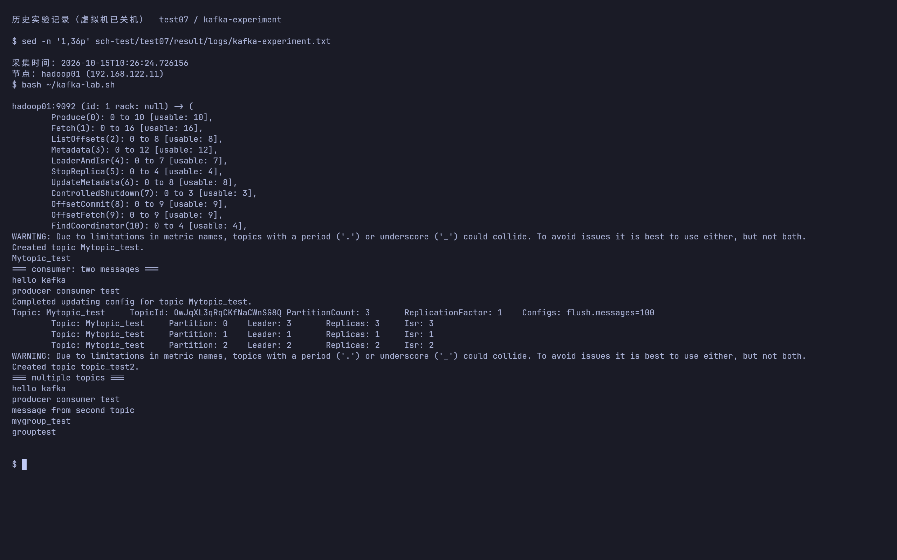
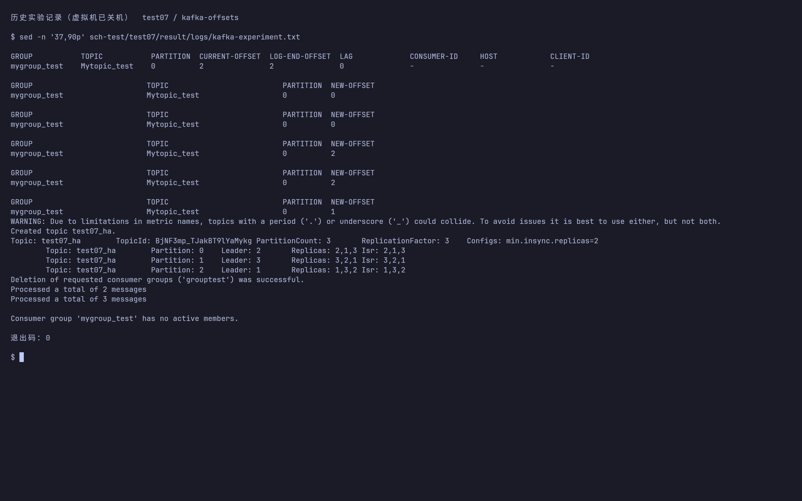
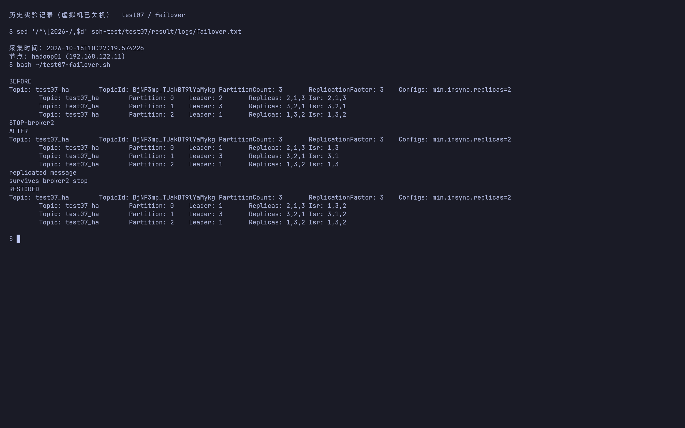

# 实验七 Kafka 集群搭建操作步骤

## 实验目标与环境

部署 Kafka 3.7.0 的 ZooKeeper 模式三节点集群，演示生产者与消费者，并练习主题、分区、消费组和位移管理。

本实验已于 2026-10-15 在本项目的三台 KVM 虚拟机上执行。下文按“操作命令、结果、截图、说明”记录；`logs/` 保存真实 SSH 命令与完整输出。Web 配图为实际集群页面截图，命令配图为 Kitty 原生终端窗口截图：终端直接用 cat、sed 或 grep 回看已采集的 SSH 原始日志，截图由 grim 直接捕获，未使用 HTML 排版或图片转换。虚拟机在补截图时保持关机，因此这些是历史执行记录的终端截图。

三台虚拟机为 `hadoop01/02/03`（`192.168.122.11/12/13`），宿主机原 SSH 别名为 `h1/h2/h3`；若系统 SSH 配置报权限错误，使用 `ssh -F /dev/null hadoop@192.168.122.11`（其他节点替换末位）连接，传包同理使用 `scp -F /dev/null` 和显式地址。JDK 为 `/usr/local/jdk1.8.0_212`，Hadoop 为 `/usr/local/hadoop`。除注明“宿主机”外，均使用虚拟机的 `hadoop` 用户；跨节点命令使用集群主机名。

Kafka 使用的版本与模式参照 [Apache Kafka 3.7 文档](https://kafka.apache.org/37/documentation/)。

本项目安装包实际为 `kafka_2.12-3.7.0.tgz`，因此使用 3.7.0 的命令参数。先完成实验五的 ZooKeeper 部分；Kafka 不依赖 HDFS 或 YARN 启动。三台虚拟机同时运行所有实验服务时需要关注内存，可先停 HBase 与不使用的 Hadoop 服务，但保留 ZooKeeper。

## 本次实验结果与截图

| 验收项 | 实测结果 |
|---|---|
| Kafka 集群 | broker.id 为 1/2/3，均正常提供服务 |
| 创建主题 | `Mytopic_test` 初始 1 分区、1 副本 |
| 生产消费 | 消费者收到 `hello kafka` 与 `producer consumer test` 两条消息 |
| 扩分区和配置 | 3 分区、1 副本、`flush.messages=100` |
| 多主题消费 | 同一消费者收到主主题两条消息及 `message from second topic` |
| 消费组查询 | mygroup_test 的分区 0 CURRENT-OFFSET=2、LOG-END-OFFSET=2、LAG=0 |
| 位移重置 | earliest→0，latest→2，指定分区位移→1，均实际执行 |
| 三副本主题 | test07_ha 为 3 分区、3 副本，正常时每分区有 3 个 ISR |
| 清理 | topic_test2 和 grouptest 删除成功 |

为便于自动完成并保留输出，生产者从标准输入发送消息，消费者用 `--max-messages` 在接收指定条数后退出，与手册两个交互窗口的收发机制相同。主主题和 mygroup_test 保留，当前位移为演示重置后的 1，故最终查询可能显示 LAG=1；上表的 LAG=0 是重置前采集结果。





附加故障实验：停止 broker 2 后，test07_ha 的分区 0 Leader 从 2 变为 1，各分区 ISR 降为两个；此时 `acks=all` 仍成功写入 `survives broker2 stop`，消费者同时读取原消息和新消息。恢复 broker 2 后，三个分区 ISR 均回到三个。



故障原始记录：[failover.txt](logs/failover.txt)，对应 [failover.sh](../failover.sh)。

最终进程、内存与 ISR 验收：[final-status.txt](logs/final-status.txt)。

原始完整执行记录：[kafka-experiment.txt](logs/kafka-experiment.txt)。可复用脚本为 [kafka-lab.sh](../kafka-lab.sh)，需在 hadoop01 执行；它按首次运行编写，同名主题已存在时不能直接重跑，可按正文选择单项操作。

## 1. 安装与环境变量

在宿主机项目根目录执行：

```bash
for host in 192.168.122.11 192.168.122.12 192.168.122.13; do
  scp -F /dev/null kafka_2.12-3.7.0.tgz "hadoop@$host:/tmp/"
done
```

三台虚拟机分别执行：

```bash
mkdir -p ~/opt
tar -xzf /tmp/kafka_2.12-3.7.0.tgz -C ~/opt
mkdir -p /home/hadoop/opt/kafka_2.12-3.7.0/data
```

三台 `~/.bashrc` 增加并加载：

```bash
export JAVA_HOME=/usr/local/jdk1.8.0_212
export KAFKA_HOME=/home/hadoop/opt/kafka_2.12-3.7.0
export PATH="$JAVA_HOME/bin:$KAFKA_HOME/bin:$PATH"
```

```bash
source ~/.bashrc
```

## 2. 配置 broker

分别编辑各节点的 `$KAFKA_HOME/config/server.properties`。保留发行包其他默认配置，修改同名属性，避免追加重复项。

hadoop01 的关键配置：

```properties
broker.id=1
listeners=PLAINTEXT://0.0.0.0:9092
advertised.listeners=PLAINTEXT://hadoop01:9092
log.dirs=/home/hadoop/opt/kafka_2.12-3.7.0/data
zookeeper.connect=hadoop01:2181,hadoop02:2181,hadoop03:2181/kafka
offsets.topic.replication.factor=3
transaction.state.log.replication.factor=3
transaction.state.log.min.isr=2
```

另外两台分别替换：

| 节点 | broker.id | advertised.listeners |
|---|---|---|
| hadoop01 | 1 | PLAINTEXT://hadoop01:9092 |
| hadoop02 | 2 | PLAINTEXT://hadoop02:9092 |
| hadoop03 | 3 | PLAINTEXT://hadoop03:9092 |

`broker.id` 必须唯一。`advertised.listeners` 必须能被客户端解析访问，不能填 `0.0.0.0`。`log.dirs` 保存消息数据，运行日志另在 `logs/`。本实验使用 ZooKeeper 的 `/kafka` 命名空间，与 Hadoop/HBase 的节点分开。

## 3. 启动与检查

在 hadoop01 检查 ZooKeeper：

```bash
~/bin/zk status
/home/hadoop/opt/apache-zookeeper-3.5.8-bin/bin/zkCli.sh -server hadoop01:2181
```

以下命令在 ZooKeeper 客户端执行，`/kafka` 已存在时跳过创建：

```text
create /kafka ""
ls /kafka
quit
```

三台节点分别启动 Kafka：

```bash
export KAFKA_HEAP_OPTS='-Xms256m -Xmx384m'
kafka-server-start.sh -daemon "$KAFKA_HOME/config/server.properties"
jps
```

预期各节点存在 `Kafka` 和 `QuorumPeerMain`。在 hadoop01 检查 broker 接口：

```bash
export BS=hadoop01:9092,hadoop02:9092,hadoop03:9092
kafka-broker-api-versions.sh --bootstrap-server "$BS"
```

后续每个新终端都需重新设置 `BS`，也可直接写完整地址。

## 4. 生产者与消费者演示

先在 hadoop01 创建主题，沿用手册的 1 分区、1 副本：

```bash
export BS=hadoop01:9092,hadoop02:9092,hadoop03:9092
kafka-topics.sh --bootstrap-server "$BS" --create --if-not-exists   --topic Mytopic_test --partitions 1 --replication-factor 1
kafka-topics.sh --bootstrap-server "$BS" --list
kafka-topics.sh --bootstrap-server "$BS" --describe --topic Mytopic_test
```

主题名区分大小写。原手册混用了 `Mytopic_test` 与 `test`，这里统一为 `Mytopic_test`。

打开终端 A，登录任意节点后启动消费者：

```bash
export BS=hadoop01:9092,hadoop02:9092,hadoop03:9092
kafka-console-consumer.sh --bootstrap-server "$BS"   --topic Mytopic_test --from-beginning --group mygroup_test
```

打开终端 B，启动生产者并逐行输入消息，回车发送：

```bash
export BS=hadoop01:9092,hadoop02:9092,hadoop03:9092
kafka-console-producer.sh --bootstrap-server "$BS" --topic Mytopic_test
```

```text
hello kafka
producer consumer test
```

预期终端 A 收到相同两行。截图时同时展示两端的命令、主题名和消息内容。按 `Ctrl+C` 退出。`--from-beginning` 只在消费组没有已提交位移时决定起点，已有位移时不会自动回放所有消息。

## 5. 主题、分区与配置管理

在任意 Kafka 节点执行：

```bash
kafka-topics.sh --bootstrap-server "$BS" --alter   --topic Mytopic_test --partitions 3
kafka-configs.sh --bootstrap-server "$BS" --entity-type topics   --entity-name Mytopic_test --alter --add-config flush.messages=100
kafka-configs.sh --bootstrap-server "$BS" --entity-type topics   --entity-name Mytopic_test --describe
kafka-topics.sh --bootstrap-server "$BS" --describe --topic Mytopic_test
```

预期 `PartitionCount: 3`、`ReplicationFactor: 1`，配置包含 `flush.messages=100`。分区数只能增加；增加分区不会自动提高副本数，已有消息也不会被重新分配。`flush.messages` 是本实验演示的刷盘配置，不能把它当作复制确认机制。

## 6. 同时消费多个主题

创建第二个主题：

```bash
kafka-topics.sh --bootstrap-server "$BS" --create --if-not-exists   --topic topic_test2 --partitions 1 --replication-factor 1
```

终端 A 使用 Kafka 3.7.0 的包含正则参数启动多主题消费：

```bash
kafka-console-consumer.sh --bootstrap-server "$BS"   --include 'Mytopic_test|topic_test2' --group grouptest --from-beginning
```

在终端 B 分别向两个主题发送消息：

```bash
printf 'message from first topic
' | kafka-console-producer.sh   --bootstrap-server "$BS" --topic Mytopic_test
printf 'message from second topic
' | kafka-console-producer.sh   --bootstrap-server "$BS" --topic topic_test2
```

消费者应收到两个主题的消息，跨主题或跨分区不保证整体顺序。手册旧参数 `--whitelist` 在这里改为 `--include`。

## 7. 消费组与位移

确保第 4 节的 `mygroup_test` 消费者运行过并消费过消息，等待自动提交位移后查询：

```bash
kafka-consumer-groups.sh --bootstrap-server "$BS" --list
kafka-consumer-groups.sh --bootstrap-server "$BS"   --describe --group mygroup_test
```

`CURRENT-OFFSET` 是已提交的下一条消费位置；`LOG-END-OFFSET` 是日志末端位置；`LAG` 是两者差值。消息被消费并提交后预期 LAG 为 0；刚创建的消费组可能暂时没有已提交位移。

重置位移前，先在所有终端中停止属于 `mygroup_test` 的消费者，再预览：

```bash
kafka-consumer-groups.sh --bootstrap-server "$BS" --group mygroup_test   --reset-offsets --all-topics --to-earliest --dry-run
```

确认预览后执行回退，重新启动消费者可回放保留的消息：

```bash
kafka-consumer-groups.sh --bootstrap-server "$BS" --group mygroup_test   --reset-offsets --all-topics --to-earliest --execute
```

以下是两个独立的其他演示方式，每次也需先停组内消费者并检查位移范围，不必连续执行：

```bash
# 跳到日志末尾，忽略现有未消费消息
kafka-consumer-groups.sh --bootstrap-server "$BS" --group mygroup_test   --reset-offsets --all-topics --to-latest --dry-run
# 指定单个分区的位移，示例 2 必须落在该分区有效范围内
kafka-consumer-groups.sh --bootstrap-server "$BS" --group mygroup_test   --reset-offsets --topic Mytopic_test:0 --to-offset 2 --dry-run
```

需要实际修改时，将相应命令的 `--dry-run` 改为 `--execute`。不要机械使用手册中的位移 2000，因为少量测试消息可能没有该位移。

## 8. 可选：验证三副本主题

手册的单副本主题无法验证 broker 故障后的副本接管。若要观察副本机制，另建一个主题：

```bash
kafka-topics.sh --bootstrap-server "$BS" --create --if-not-exists   --topic test07_ha --partitions 3 --replication-factor 3   --config min.insync.replicas=2
kafka-topics.sh --bootstrap-server "$BS" --describe --topic test07_ha
printf 'replicated message
' | kafka-console-producer.sh   --bootstrap-server "$BS" --topic test07_ha --producer-property acks=all
```

预期每个分区有三个 Replicas 和三个 ISR。记录某个分区的 Leader，在该 broker 节点执行 `kafka-server-stop.sh`，再次 describe，观察新 Leader 和 ISR，再启动该 broker 并等待 ISR 恢复。测试期间保留至少两个 broker 在线。

## 9. 清理与停止

停止所有实验消费者后，仅清理不再需要的实验资源：

```bash
kafka-topics.sh --bootstrap-server "$BS" --delete --topic topic_test2
kafka-consumer-groups.sh --bootstrap-server "$BS" --delete --group mygroup_test
kafka-consumer-groups.sh --bootstrap-server "$BS" --delete --group grouptest
```

本次删除了第二主题 `topic_test2` 和消费组 `grouptest`；主主题 `Mytopic_test`、三副本主题 `test07_ha` 与 `mygroup_test` 保留以便验收。三台节点分别执行 `kafka-server-stop.sh`，确认 Kafka 已退出后，再按需停止 ZooKeeper。

## 10. 完成检查与排障

- 三个 broker 的编号唯一，客户端可以解析 advertised 主机名。
- 同一主题的生产者消息能被消费者读取。
- 扩分区后显示三个分区，配置查询能找到刷盘设置。
- 消费组位移可查询；停止消费者后可预览并重置位移。

连接失败时检查 9092 监听、主机名解析、`advertised.listeners` 和 `logs/server.log`；启动失败时检查 ZooKeeper 的 2181、`/kafka` 命名空间、broker ID、数据目录权限与内存。若旧数据中的集群身份与 ZooKeeper 不一致，先核查是否误连了另一套 ZooKeeper，不直接删除数据目录。

## 命令参考

多主题订阅参数已核对 [Apache Kafka 3.7.0 ConsoleConsumer 源码](https://github.com/apache/kafka/blob/3.7.0/core/src/main/scala/kafka/tools/ConsoleConsumer.scala)：`--include` 可用，`--whitelist` 为保留的弃用参数。
